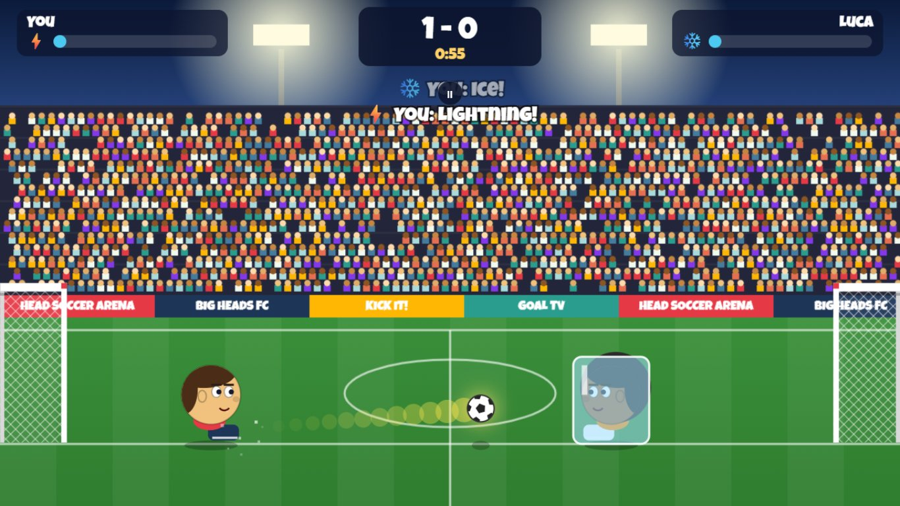
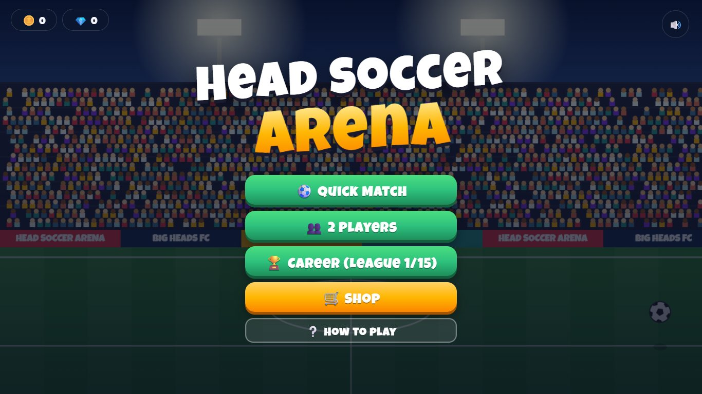

# Head Soccer Arena

A fast, arcade-style "big head" football game for the browser, written from scratch in plain HTML, CSS and JavaScript on a single `<canvas>`. No build step, no frameworks, no network requests.



**Play online:** the game will be available at https://fadlonerez-sketch.github.io/head-soccer-arena/ once GitHub Pages is enabled for this repository. Until then, run it locally (below).

## What it is

A complete, self-contained casual game: 1v1 matches against a computer opponent or a friend on the same keyboard, a 15-league career, a shop with upgrades, super powers and unlockable characters, and progress saved in the browser. It works with a keyboard on desktop and with on-screen touch buttons on phones and tablets.

## Features

- **Three modes**
  - **Quick Match** against the computer at Easy, Normal or Hard.
  - **2 Players** on one keyboard; each player picks any character and power.
  - **Career**: 15 leagues x 3 matches with steadily stronger opponents. Win to advance; finishing a league pays diamonds.
- **Computer opponent**: positions itself behind the ball, predicts where the ball is going, jumps for headers and kicks when close. One skill value (0-1) controls its reaction time, prediction distance, accuracy and when it fires its power.
- **Super powers** (charge the power bar over time and by touching the ball):
  - Ice - freezes the opponent for a few seconds
  - Lightning - your next kick becomes a thunder shot aimed at goal
  - Anvil - drops an anvil that stuns the opponent
  - Giant Head - your head grows for several seconds
- **Shop**: coins buy upgrades (speed, jump, kick, power charge; 5 levels each) and powers; diamonds unlock 6 more characters (7 in total) with different speed, jump and kick stats.
- **Physics**: gravity, bounces off heads, feet, crossbars and walls, and kicks with a short swing window, all on a fixed 60 steps-per-second clock.
- **Synthesized sound effects** via the Web Audio API (no audio files), with a mute button.
- **Responsive**: the 16:9 game box scales to any window; touch controls appear on touch devices.
- **Saved progress** in `localStorage`, validated on load (see Security).



## Controls

| | Move | Jump | Kick | Power |
|---|---|---|---|---|
| 1 player | A / D or ← / → | W or ↑ | Space (also F or K) | S or ↓ |
| 2 players, left | A / D | W | F | S |
| 2 players, right | ← / → | ↑ | K | ↓ |

Esc or P pauses. Keys are matched by physical position (`KeyboardEvent.code`), so they also work with non-English keyboard layouts. On touch screens use the on-screen ◀ ▶ ▲ KICK ⚡ buttons.

## Tech stack

- Vanilla JavaScript (ES2020+), HTML5 Canvas 2D, CSS, Web Audio API
- Self-hosted title font (Luckiest Guy, Apache-2.0)
- Tests: Node.js + [puppeteer-core](https://pptr.dev/) driving headless Chrome

## Requirements

- To play: a modern desktop or mobile browser (automated tests run in Chrome).
- To run the tests: Node.js 22.12 or newer and Chrome/Edge installed (or let the test runner download Chrome Headless Shell).

## Run

No install or build needed. Either open `index.html` directly in a browser, or serve the folder:

```bash
git clone https://github.com/fadlonerez-sketch/head-soccer-arena.git
cd head-soccer-arena
python -m http.server 8000      # then open http://localhost:8000
```

## Tuning the game

Every gameplay number and all content live in [`config.js`](config.js) - edit, save, refresh:

- `CONFIG` - canvas size, gravity, ball bounce/drag/max speed, player speed, jump and kick power, goal size, match length (`MATCH_SECONDS`, default 60), power-meter fill rates, career size (`LEAGUES`, `MATCHES_PER_LEAGUE`), rewards and upgrade costs/effects
- `KEYMAP` - key bindings for single player and both 2-player sides
- `AI_LEVELS` - computer skill for Easy / Normal / Hard
- `POWERS`, `UPGRADES`, `CHARACTERS` - prices, durations, stats and looks
- `LEAGUE_NAMES`, `OPPONENT_NAMES`, `DEFAULT_SAVE`

## Saved games

Progress (coins, diamonds, owned characters and powers, upgrade levels, career position, mute setting) is stored in the browser's `localStorage` under the key `headSoccerArena.save.v1`. It stays on your device. On load, every field is type-checked, clamped to its valid range or checked against the known ids; anything invalid falls back to the default, so a corrupted or edited save cannot break the game or inject markup.

## Security

- A restrictive Content-Security-Policy (`<meta>` in `index.html`) allows only the game's own scripts, styles and font; inline scripts, network connections and plugins are blocked.
- The game makes no network requests (the font is self-hosted), and the tests verify this.
- No `eval` / `new Function`; dynamic HTML is built only from the game's own constants and sanitized numbers.

## Run tests

The test suite opens the real game in a **headless** browser (no window is shown), plays it with simulated key and touch events, and checks menus, controls, physics, scoring, powers, shop, career, 2-player mode, phone layout, the CSP, saved-game sanitizing and that no request leaves the computer.

```bash
cd tests
npm ci
node run-tests.js
```

Latest local run: **54 passed, 0 failed, 0 skipped (of 54 checks)**. A text report and screenshots are written to `tests/report/` (git-ignored). If no Chrome or Edge is installed, run `node run-tests.js --install-browser` once.

The same tests run in GitHub Actions on every push ([`.github/workflows/tests.yml`](.github/workflows/tests.yml)).

## Project structure

```
index.html        page markup: canvas, menus, overlays, touch buttons
config.js         all tunable numbers and game content
game.js           engine: input, physics, players, AI, powers, match, rendering, sound
ui.js             menus, shop, career, 2-player setup, saving, touch controls
style.css         menus and overlays
fonts/            self-hosted Luckiest Guy font + its Apache-2.0 license
tests/            headless browser test suite (puppeteer-core)
docs/images/      README screenshots (taken by the test suite)
.github/workflows tests.yml (CI) and pages.yml (manual GitHub Pages deploy)
```

## Deploying to GitHub Pages

The game is fully static and uses only relative paths, so it works from a sub-path. To publish it: in the repository go to **Settings > Pages**, set **Source** to **GitHub Actions**, then run the **Deploy to GitHub Pages** workflow from the **Actions** tab. It publishes only the game files (`index.html`, `config.js`, `game.js`, `ui.js`, `style.css`, `fonts/`), not the tests or docs.

## Known limitations

- Single device only: there is no online multiplayer.
- Progress is stored per browser; clearing site data resets it, and there is no cloud sync or export.
- The computer opponent is rule-based (no learning), so experienced players will find patterns.
- Sound effects are simple synthesized tones.

## License

[MIT](LICENSE) (c) 2026 fadlonerez-sketch. The bundled Luckiest Guy font by Astigmatic is licensed separately under the Apache License 2.0 - see [`fonts/LICENSE.txt`](fonts/LICENSE.txt) and [`fonts/README.txt`](fonts/README.txt).
